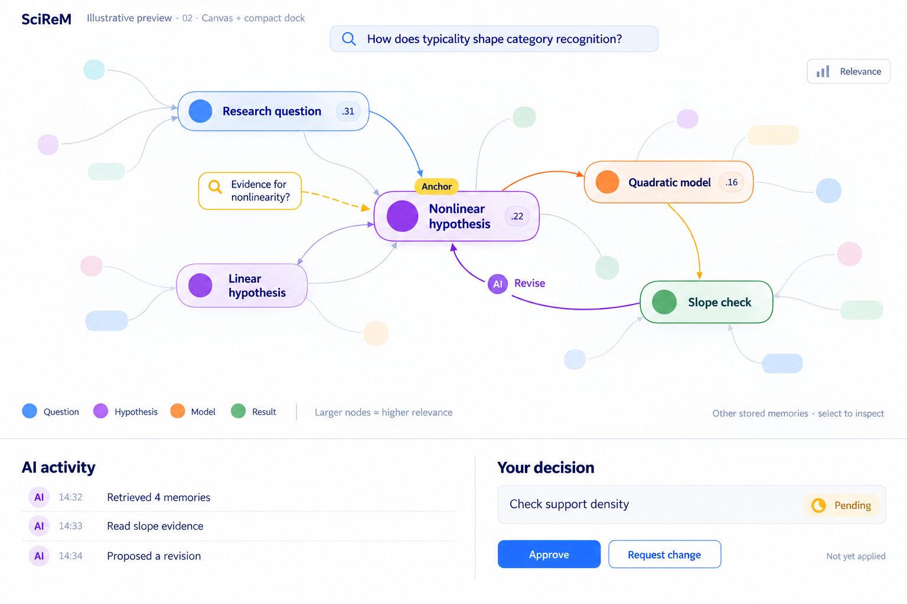

# SciReM — Scientific Research Memory

SciReM is a memory system for cumulative, inspectable human–AI social-science research. 

The aim of SciReM is to connect **evidence → interpretation → decision → next inquiry**, so earlier judgments can be inspected and reconsidered. The prototype implements a source-linked scientific graph, query-anchored retrieval with personalized PageRank, compact TSV packets, statistical execution receipts, and a research controller. Improved scientific judgment, reduced repetition, and better human review remain research questions.

**Start here:** [paper–code alignment](docs/CLAIMS.md), [technical appendix](docs/technical-appendix.md), [preliminary evidence](docs/preliminary-evidence.md), [evaluation plan](docs/evaluation.md).

## Dashboard design preview



Selected interface design: a query-anchored memory map with PageRank relevance, AI activity and human researcher decisions. This AI-generated design concept uses illustrative records and scores; it is not a screenshot of the running prototype or an empirical result. Implementation is in progress.

## What is available 

1. **If you don't have an AI model account or dataset:** two scripted cycles through the real controller, graph publication, retrieval and dashboard generation. This validates wiring; responses and statistics are fixtures.
2. **If you have an AI model account and compatible data:** the actual memory-enabled research loop using the same controller and R Runner as the development experiments. The current tool/data dictionary is specific to the processed category-classification pilot. Setting a different CSV path does not support arbitrary datasets.

This version retains Linux/SGE allocation checks and bubblewrap isolation. The functionality had been checked under a university cluster, where all execution run inside an allocated compute job. Python3.10+ and `jsonschema` are needed; real statistical execution additionally needs R, `survival`, `sandwich`, `lmtest`, `fixest`, and bubblewrap. Hosted calls require an installed Codex CLI and the user's own authorized account/model access. 

## Install and run the scripted smoke

From the repository root, inside a compute allocation:

```bash
python -m venv .venv
. .venv/bin/activate
python -m pip install '.[experiment]'
export PYTHONPATH="$PWD/src:$PWD/tools:$PWD/tests"
python tools/smoke_scirem.py --output "$PWD/workspaces/smoke-01"
```

Choose a new output directory on every run. Open `workspaces/smoke-01/dashboard.html` in a browser; At current stage, it is a static artifact, not a live agent animation. Inspect `memory.tsv`, `trace.json`, `report.json`, and the per-attempt source receipts. The trace distinguishes query anchors, ranking and final context inclusion. `report.json` must explicitly identify `scripted_fixture` and `fixed_test_receipts`.

This exercises `execute_four_role_attempt` twice with the actual shared-memory implementation. It does **not** execute an LLM or real R model and cannot reproduce the empirical preliminary-results table.

Tests, from the same allocated environment:

```bash
python -m unittest discover -s tests -v
python -m unittest newtest_diagnostic_handoff -v
```

The second command covers a retained regression file whose historical name falls outside normal unittest discovery.

## Run the actual pilot loop

First obtain data with the schema and provenance described in [data requirements](docs/data-and-runtime.md). Confirm permission to process it through the chosen model service. Authenticate the CLI using its normal procedure in your own environment; never put authentication files in this repository.

Set site-specific paths before starting Python, inside the reviewed allocation:

```bash
export PYTHONPATH="$PWD/src:$PWD/tools:$PWD/tests"
export SCIREM_DATA=/absolute/path/to/compatible/styles.csv
export SCIREM_R_HOME=/absolute/path/to/R/home
export SCIREM_R_LIBRARY=/absolute/path/to/R/site-library
export SCIREM_OUTPUT=/absolute/path/to/new-run-output
export SCIREM_ROLE_LAYOUT=unified
export SCIREM_REVIEW=off
export RESEARCH_AGENT_ALLOW_CHILD_CLEANUP=1
python tools/run_scirem.py \
  --round 1 --budget-seconds 300 \
  --backend codex --codex-model YOUR_ACCESSIBLE_MODEL \
  --embedding-backend lexical --adaptive-shared-context \
  --trajectory-root "$SCIREM_OUTPUT/trajectories/run-01"
```

