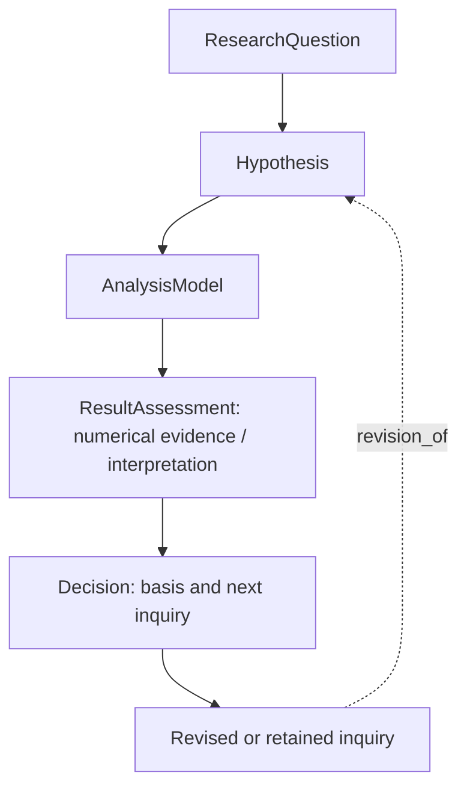

# Technical appendix: current prototype and proposed extensions

## 1. Scientific object represented

SciReM preserves components of scientific judgment, rather than treating a conversation summary as authoritative knowledge. The current scientific graph has five principal node types. The immutable ResearchQuestion roots a trajectory. Hypothesis records retain the expected pattern, rival explanation, adaptation and declared focal test. AnalysisModel records preserve the requested specification and relevant design assumptions. ResultAssessment separates source-derived numerical evidence from agent assessment. Decision retains the action, compact basis, cited evidence and next inquiry.

This diagram shows the research sequence. Stored edges often point back to their sources: Hypothesis→RQ `addresses`; Model→Hypothesis `intended_test_for`; Result→Model `produced_by`; Decision→Result `based_on`; later Hypothesis→earlier Hypothesis `revision_of` and →prior Decision `follows_decision`. These provenance links are distinct from the newly implemented judgment edges described below.

Result→Hypothesis `supports` represents a significant declared focal coefficient in the expected direction. `challenges` represents a significant coefficient in the opposite declared direction. Non-significant, unavailable, failed or zero-effect tests do not automatically produce a challenge. Model→Hypothesis `assumption_constraint` records the model's actual identification-assumption text with `declared_not_validated` status. Every judgment edge preserves its basis, scope and source/hash provenance; scientific validity remains unverified. The existing publication path creates these edges for new records, retrieval/PPR uses them, and TSV packets carry their metadata. Source-derived semantics are checked when records are read. Historical archives are not silently relabeled. Independent assumption nodes and researcher-confirmed judgment revisions remain future work.

`TwoRoleMemory` is a historical class name; the actual controller can use unified or separate research-role contexts. Candidates are immutable and published by the scheduler-owned writer. Sources and hashes are checked against recorded plans/results. A changed source must not silently inherit the validity of its earlier receipt. Machine statistical checks use the declared primary test, estimated coefficient, direction and configured significance threshold; failed or non-estimable tests are distinguished from non-significant estimates. The pilot uses alpha=.10. This is an exploratory convention, not a universal standard or proof of substantive support.

## 2. Retrieval and active context

The shared memory code retrieves on demand using query-matched anchors and personalized PageRank over connected records. The latest tested pilot can use lexical matching without embeddings. Optional semantic indexing is a separate configuration. Full source archives are retained outside active context; C can compact private working history and recall source-linked records. Archive preservation is not equivalent to retransmitting the complete history on each call.

The application records anchor seeds, relevance scores, selected sources and final TSV context. Equivalent results can be grouped without assuming that different result identifiers imply new evidence. Numerical fields and source order must remain faithful. Rationale and decision components are compact fields, not a guarantee that a model reads them correctly. PPR is an attention mechanism; popular or well-connected judgments can still be mistaken. Its incremental value over similarity-only retrieval requires an ablation.

## 3. Execution and error feedback

The existing controller routes Hypothesis→analysis planning→Runner→assessment→Decision. Role layout and independent review are configurable. Deterministic routing checks receipt provenance; optional scientific review asks an LLM to assess requested-test fulfillment and claim/evidence agreement. Neither guarantees correctness.

The primary statistical Runner generates R from validated specifications and uses established statistical packages. Model families currently include linear, logit and conditional logit; extensions require a supported tool/data contract, not merely a label in a plan. Optional custom R diagnostics execute in the same restricted environment. Complete-case/sample rules, strata, uncertainty and actual output must be inspected together. Error receipts preserve submitted code and safe actionable diagnostics. Agent repair then runs again; code existence and process exit alone are insufficient outcome criteria.

A development failure illustrates the distinction: R named logical-predictor interaction coefficients with a TRUE suffix, while a diagnostic requested the unsuffixed coefficient. The primary fit succeeded but the extra diagnostic failed. A second source-matching bug missed that R deparses single-quoted strings with double quotes. Source-grounded feedback and explicit binary conversion repaired both tested cases without silently substituting another coefficient. These are tested examples of recovery, not universal failure prevention.

## 4. Human direction and current boundary

The artifact provides source inspection and retrieval views. The older generic workflow can record verbatim user decisions. This is separate from a fully integrated typed-graph workflow in which researchers confirm, reject or revise judgments, specify their rationale, and have the next research action checked for uptake. That integration and its evaluation are planned. Similarly, methodological assumptions can occur within existing model payloads; independently addressable assumption/concern records are not complete.

## 5. Reproducibility and scientific assessment

`smoke_scirem.py` uses the real controller and graph with scripted model/statistical fixtures; its synthetic labels are explicit. It checks infrastructure, not the preliminary empirical findings. The release exports the real experimental modules with path configuration changes listed in `portability-changes.md`. A real pilot run still requires the matching dataset, installed statistical packages, sandbox permissions and authorized model access. Hosted model versions and stochastic generation may prevent exact response replication.

Separate four outcomes: workflow completed; numerical result available; requested test fulfilled; scientific validity supported by independent review. One must not stand in for another. In prospective evaluation, freeze source/model/task/resource conditions and score original-paper rediscovery separately from defensible new findings. Preserve unsuccessful and censored trajectories. Do not feed the hidden reference paper, evaluator answers or QA conclusions to discovery agents.

## 6. Contribution and limitations

Graph retrieval and PPR build on existing methods, including HippoRAG (Gutiérrez et al.,2024, https://arxiv.org/abs/2405.14831). The proposed contribution is a representation and evaluation of cumulative scientific judgment in human–AI collaboration. Current preliminary evidence supports feasibility and exposes failures. No demonstrated general improvement in novelty, research quality, human attention, tokens or repetition is claimed. Development must address unsupported interpretation, retrieval bias, stale judgments, missing methodological tests, data rights and accessible deployment before broader adoption.
